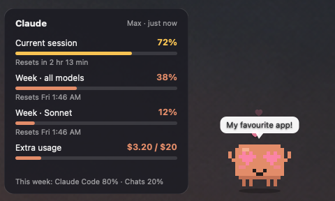
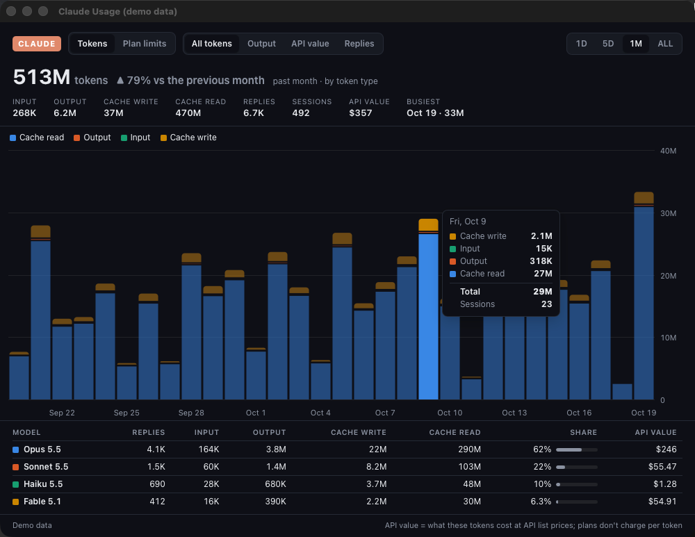
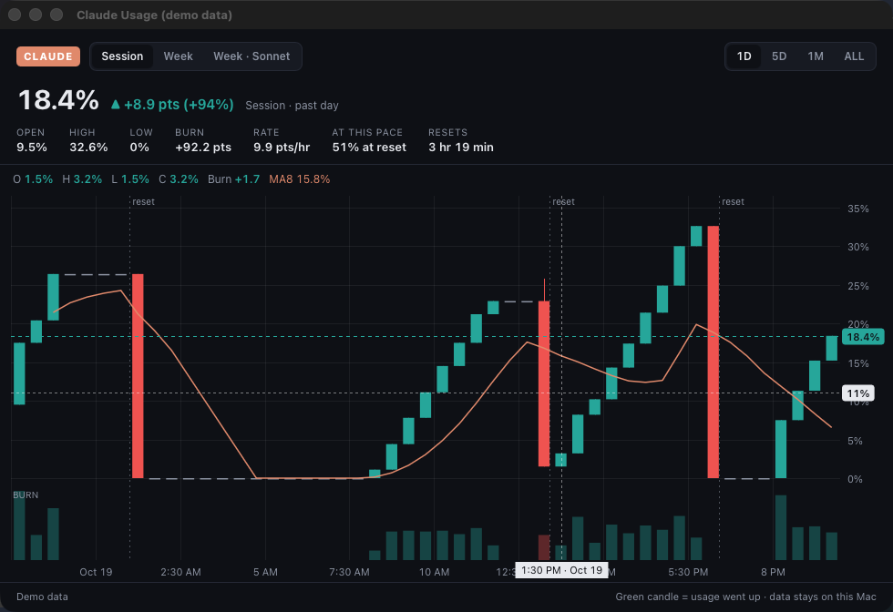
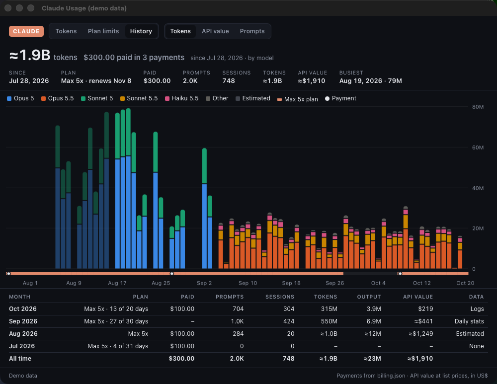
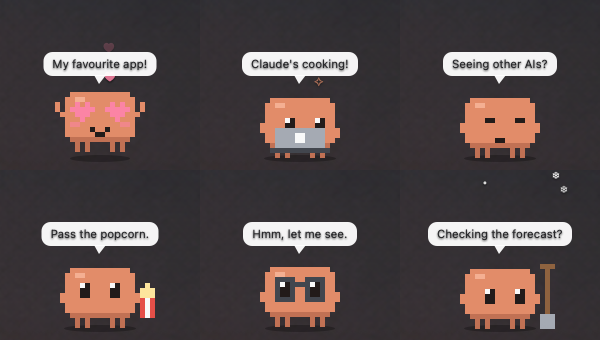
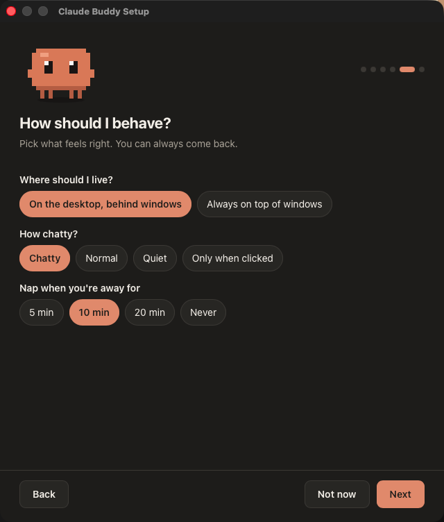

# Claude Usage Widget + Buddy

A macOS desktop widget that shows your Claude plan usage, plus a little pixel Claude
that reacts to whatever app you're in and knows your Claude Code sessions by name. Runs
on [Hammerspoon](https://www.hammerspoon.org). The buddy runs on plain rules; give it
Claude Haiku or a local Ollama brain and it jokes about what's on your screen and chats back.



## What you get

**The usage card** shows the same numbers as Claude Code's `/usage`:

- The current 5-hour session, your weekly limits (all models and per model), any
  credits, and extra usage if you've turned it on, each with a reset countdown
- A refresh every 5 minutes and after your Mac wakes. It keeps showing the last
  numbers through restarts and outages
- Bars that turn amber at 70% and red at 90%
- An **API value** line: what your Claude Code use would cost at API prices for the period
  you pick, how many times over your plan that is, and a fun comparison Buddy says out loud
  (more below)
- A strip of hourly bars for your last 24 hours of Claude Code tokens, with the day's
  total tokens, replies and what they'd cost at API prices
- Drag it anywhere; it remembers the spot

**The usage chart** opens when you click the card. **Tokens** and **Plan limits** come in
**1D / 5D / 1M / ALL** ranges with a hover readout; **History** shows your whole account.

**Tokens** reads the session logs Claude Code already keeps on your Mac, so it shows
your history from day one (as far back as Claude Code has kept logs, about 30 days):



- **All tokens** stacked by type (cache read, output, input, cache write), or
  **Output**, **API value** and **Replies** stacked by model
- Totals for the range: input, output, cache write and read, replies, sessions, the
  busiest hour or day, and the change from the previous period
- A table by model: replies, every token type, share, and API value
- **API value** is what those tokens would cost at Anthropic's API list prices. It's a
  sense of scale; a Pro or Max plan doesn't charge per token

**Plan limits** plots your plan percentages like a stock chart:



- Candlesticks per period (green when usage went up, red when a reset dropped it),
  with a **burn** pane underneath showing how much you used in each period
- Tabs for each limit (session, week, per model)
- A moving average, the current value tagged on the axis, dotted lines where limits
  reset, and a crosshair that reads out each candle
- **At this pace**: where you'll land by the next reset at your current rate, or when
  you'll hit 100% if that comes first

Plan-limit history starts the day you install it: the card saves a point every time it
checks (every 5 minutes while your Mac is awake).

**History** is everything back to your first day, a bar per day with a table by month:



- **Tokens** and **API value** by model, or **Prompts** typed per day
- A strip under the bars showing when you had a paid plan, with a dot on each payment
- Month by month: plan, what you paid, prompts, sessions, tokens, output, API value,
  and where the numbers came from (logs, Claude Code's daily stats, or an estimate)
- Faded bars are estimates. Claude Code's daily stats keep a total per model, so the
  split into token types (and so the API value) follows that model's lifetime mix. Days
  from before Claude Code kept tokens per day get the rest of its lifetime totals,
  spread by how busy each day was

Claude Code deletes its session logs after about 30 days, but it keeps daily totals for
`/stats` and the time of every prompt you typed. Turn on **older history** in the setup
wizard (or set `import_history = true` in `config.lua`) and the card copies those
numbers in and keeps them for good, even after Claude Code prunes its files. Only
numbers are copied, never what you typed. A month without logs or daily stats says so
in the table instead of looking quiet. Run `/stats` in Claude Code now and then to
keep its daily totals current.

**What you paid** is up to you to add, since the card can't see your receipts. Save a
`billing.json` next to the card's data, in
`~/Library/Application Support/claude-usage-widget/`, with one entry per payment from
your Anthropic receipt emails (`from`/`to` are the billing period on the receipt;
`events` and `ref` are optional):

```json
{
  "currency": "$",
  "charges": [
    { "date": "2026-03-04", "amount": 100.00, "plan": "Max 5x", "from": "2026-03-04", "to": "2026-04-04", "ref": "Receipt 1234-5678" },
    { "date": "2026-04-04", "amount": 100.00, "plan": "Max 5x", "from": "2026-04-04", "to": "2026-05-04" }
  ],
  "events": [{ "date": "2026-04-20", "text": "Cancelled" }]
}
```

**API value.** The card's API value line is what your Claude Code use would cost at Anthropic's API list
prices, for the period you pick. Click it for Session (your plan's 5-hour window), Today, Week
(your plan's week), Month, Year to date or All time. It counts the same numbers as the chart's
History tab, plus Buddy's own Claude use where the card tracks it (the same menu can leave
that out). Only Claude Code counts: chats in the Claude app or on claude.ai leave no logs on
your Mac.

Under it, "6.4× your plan" compares that with what you paid for the same days: your
`billing.json` receipts where you have them, otherwise the plan price you picked in the setup
wizard (`plan_price` in `config.lua`, US dollars a month). Without either, that line stays
hidden.

Below that sits a fun comparison, like "🍕 That's 71 large pepperoni pizzas". It stays put
until the dollars have moved by about as much as that period usually varies, then Buddy's
brain writes a fresh one and Buddy says it out loud. Without a brain, they come from a
built-in list. They stick to everyday things: food, cars, gadgets, travel, sports, buildings.

To see every view full of made-up data (the card's API value line too), run
`hs -c 'ClaudeUsage.chart(true)'`.

**The buddy** stands next to the card and reacts to the app and window in front:



| You're in… | The buddy… |
|---|---|
| Terminal / Ghostty / iTerm | types on a laptop |
| …with Claude Code working | types, with sparkles flying up |
| …with Claude Code waiting on you | hops and waves: "Your turn!" |
| Claude app or claude.ai | heart eyes, bouncing |
| ChatGPT / Grok / Gemini | gives that window the side-eye |
| YouTube, Netflix, Stremio | eats popcorn |
| Gmail / Mail | holds an envelope |
| Sheets, Docs, PDFs, Obsidian | puts on glasses |
| Weather or snow forecast | grabs a shovel while it snows |
| Finder | looks around with question marks |
| System Settings | twists a wrench |
| Games / PS Remote Play | mashes a controller |
| Music / Spotify | dances to floating notes |
| Anything else | "Ooh, *AppName*!" |

It also follows your mouse with its eyes, blinks, fidgets and dances, gets bored after
3 minutes away, falls asleep after 10 (and jumps when you come back), drinks coffee in
the morning, gets sleepy late at night, sweats when your session is 80% used, and
cheers when it resets. On "chatty" it pipes up by itself every minute or so.

**Your Claude Code sessions.** The buddy reads each session's name from the terminal
title. Click into one and it says something about it ("Bug hunt! Get it!", "*Refactor
the API* is still cooking."). When a session in the background finishes, it waves:
"*Fix the login bug* finished after 12 min!"

**Things happening on your Mac.** It reacts when your Mac wakes or unlocks, a screen or
USB gadget is plugged in, headphones connect, the internet drops or comes back, a drive
mounts, you take a screenshot, a download finishes, or an app crashes. You can add
your own: a log file to watch for a line, or a folder to watch for new files (see
`events` in `config.example.lua`).

| Do this | To |
|---|---|
| Click | chat with it (with a brain), or get a hello |
| Click its speech bubble | open the chat on what it just said (with a brain) |
| Shift-click | have it look at your screen and say something |
| Cmd-click | open a new Claude Code session in Terminal |
| Right-click or Ctrl-click | its menu: chat, standing jobs (with Claude), a joke, a skin to wear, Halloween skits (October 24–31), a new Claude Code session in any project folder, session and usage reports, **Buddy's usage**, **Brain**, **Watching**, **Forget what you've learned about me…**, quiet for an hour, setup, report a bug |
| Option-click | the setup wizard |
| Drag | move it |
| Shake it while you hold it | it panics and snows like a snow globe, then reels around seeing stars (shake it too often and it gets grumpy) |

**Skins.** Right-click → **Skin** to dress the buddy up: colours, outfits, memes,
superheroes, games and anime, movies and TV, and Halloween costumes, over 60 in all,
or **Surprise me** for a random one. Each skin has its own reactions (shake the Witch
and bats fly out, shake the Pumpkin and it spits seeds) and a few lines of its own,
and with a brain the buddy knows what it's dressed as. Your pick sticks across restarts
and updates. To browse them all, animated, with buttons to play each one's reactions:

```sh
tools/skins-gallery        # tools/skins-gallery stop to stop its little local server
```

**Halloween.** From October 24 to 31 the buddy puts on a witch hat (unless you've
already picked a Halloween skin) and holds a jack-o'-lantern candy pail. A spider
dangles from a web in the corner, and every few minutes a little skit plays: a bat lands
on the hat, a bat steals the candy, a zombie gives chase, trick-or-treaters come by,
and a few nods to classic horror movies. How often follows `chatter`, and a click or a
real event ends a skit straight away. Its lines and jokes go spooky too, and with a
brain it knows it's Halloween. Right-click → **Halloween** turns it off or on for the
year, plays a **Spooky surprise**, or picks any skit by name. On November 1 it packs up
and the buddy goes back to its own skin. `halloween = true` in config.lua keeps it on
all year, `false` keeps it off. To watch every skit:

```sh
tools/skits-gallery        # tools/skits-gallery stop to stop its little local server
```

**The brain (optional).** Pick **Auto**, Claude **Haiku**, **Sonnet**, **Opus** or
**Fable**, **Ollama on this Mac**, or **Plain rules** in the wizard or the right-click
**Brain** menu. Switching between Claude models from that menu takes effect at once;
switching to or from Ollama or plain rules restarts Buddy. Auto uses Haiku for
short lines, notes and learning, and Opus for chat and jobs. For a research question
in chat, Opus can ask Sonnet helpers to find and read things. If a model is unavailable,
Auto tries another for chat and jobs (quick work is always Haiku). A named Claude model
handles all of Buddy's work, including helpers.

For Ollama, install [Ollama](https://ollama.com) and one model:

```sh
brew install ollama && brew services start ollama
ollama pull gemma3:4b
```

With a brain, the buddy looks at windows it doesn't know (a screenshot of that one
window) and makes a crack about them, riffs on your Claude Code sessions, tells jokes
about what you're doing, and chats in a little panel next to it. With Ollama, pictures
stay on this Mac; with Claude, they go to Anthropic through your Claude Code login.
Pictures are never saved. Set `peek_every` for unprompted looks every few minutes.

**Claude brain.** Set `ai = { engine = "claude", model = "auto" }` in `config.lua`
or choose Auto in the wizard. It uses your Claude plan to chat, find and read
files, and run standing jobs. Buddy can't send anything, change files or run commands.
`daily_unprompted` caps the lines it starts on its own each day (300 by default).
Ask Buddy in chat to make a standing job, such as a daily briefing, then use the
**Jobs…** menu item to see your jobs. A sit-down job runs when you return after at
least four hours away, after 5 AM. Results open in the chat panel when you're here.
When you're away, paired Telegram gets the result instead, unless you set
`telegram.jobs = false`.
Use `/watch 30m <what to check>` in chat or Telegram for a temporary check until
tonight. `/watches` lists them and `/unwatch 2` stops number 2. Watches run at
least 15 minutes apart and at most 40 times a day across all watches by default;
`ai.watch_min` and `ai.watch_runs` change those limits. A watch stays quiet when
there's nothing new. A watch made on Telegram sends its updates there even while
you're at your Mac. Watches need the Claude brain.
To let a job read a local source, add a named read-only command under `ai.sources`,
such as `date = { cmd = { "/bin/date" }, about = "Current date and time" }`, then
ask Buddy to include that source in the job. See `config.example.lua` for the other
Claude settings.

The chat and the speech bubble are one conversation: whatever the buddy says out loud
also lands in the chat (live, if the panel is open), and opening the chat shows its last
five lines, so you can answer one. After you chat, it jots down short, numbered notes
about you (what you're working on, running jokes) and brings them up next time. Type
`/notes` to read them or `/forget 3` to remove note 3; the same commands work on
Telegram. Right-click Buddy → **What I remember about you…** opens the list in chat.
New or changed notes appear as a small grey “📝 Noted” line. Drag the
chat by its header to move it; it opens in that spot next to the buddy from then on.

**Talk instead of typing.** In the chat, hold space and talk, then let go, like Claude
Code's voice mode; a quick tap still types a space. The words land in the box for you
to send. It's transcribed on your Mac by [whisper.cpp](https://github.com/ggml-org/whisper.cpp):

```sh
brew install ffmpeg whisper-cpp
mkdir -p ~/.cache/whisper.cpp
curl -L -o ~/.cache/whisper.cpp/ggml-base.en.bin \
  https://huggingface.co/ggerganov/whisper.cpp/resolve/main/ggml-base.en.bin
```

Hammerspoon asks for the microphone the first time. `base.en` is small and quick;
`large-v3-turbo` is more accurate. It uses the first model it finds in
`~/.cache/whisper.cpp`, or the one you name in `ai.dictation`.

**Text it from your phone.** With [Telegram](https://telegram.org) you can chat with the
buddy when you're away from the Mac. In the setup wizard, say yes to Telegram and make a
bot with [@BotFather](https://t.me/BotFather): send it `/newbot`, pick a name, and it
replies with a token. Paste the token, point your phone's camera at the code the wizard
shows, and tap **Start** in Telegram. Only the Telegram account that sent the code gets
answers; the bot ignores everyone else.

It's the same conversation as the chat panel: your texts show up there marked Telegram,
and the buddy answers through its brain knowing you're away. It can't see your screen
from there, but it knows how your Claude Code sessions and plan usage look. `/usage` and
`/sessions` answer straight from the card, even without a brain. `/notes` lists Buddy's
notes and `/forget N` removes one by number. Voice notes work when
hold-to-talk is set up (above): they're transcribed on your Mac and deleted. Your Mac
has to be awake to answer. The bot token lives in your Mac's Keychain, not in
`config.lua`; choosing **No thanks** in the wizard later removes it. Anyone who gets into
your Telegram account can chat with the buddy, including asking it to read files it's
allowed to read, so turn on Telegram's two-step verification.

With a Claude brain, Telegram shows an answer as Claude writes it, then replaces the
preview with the finished answer. Set `telegram.streaming = false` to wait for the full
answer instead. `telegram.streaming = "draft"` uses Telegram's private-chat draft
preview where available and falls back to message edits if it fails. Ollama replies
arrive when they're complete.

You can send a photo with a caption, or just a photo, and the buddy will look at it with
its chosen brain. Photos go to Anthropic when you chose Claude, or stay on your Mac when
you chose Ollama, like screenshots. The temporary download is deleted after Buddy reads
it. If you send another message right after a photo, Buddy reads the photo first. The
bot's command menu shows the commands you turned on. It marks messages as read
and answered, and its short description says whether the Mac is awake. When Buddy asks
about starting a task session, tap **Start** or **No**, or type your answer. A voice note
gets a text answer and, by default, a spoken answer too. Set `telegram.voice_replies` to
`"always"` to hear every reply, including task updates, or `false` for text only;
`telegram.tts` can name a speech command if you prefer one over macOS `say`.

**Hand it a bigger job.** Ask in the chat or on Telegram, like "start a session to add a
dark mode to my app", or send `/task` and what it's for. The buddy asks for a yes, then
opens a Claude Code session just for that job in a new Terminal window, with Remote
Control on, and sends you its link so you can drive it from the Claude app on your
phone. When the session finishes a turn or needs your OK, the buddy passes it on: in the
chat and the bubble, and on Telegram when the job came from there or you're away from
the Mac. Reply to one of those Telegram messages, or tell the buddy in the chat, and your
answer is typed into the session. `/tasks` lists the sessions and `/stop 2` ends one; the
right-click menu's **Task sessions** reopens a window, copies a link or stops one.
Sessions run on their own tmux server (`brew install tmux`), so closing the window leaves
the job running; without tmux they run straight in Terminal and you answer them in the
Claude app. They're ordinary Claude Code sessions, with your settings, permissions and
plan usage, and Remote Control needs Claude Code signed in with a Claude plan. Set
`tasks = false` in `config.lua` to turn this off.

Permission questions come with **Allow once** and **Deny** buttons on Telegram.
A tap answers just that tool call; it doesn't change the session's permission settings.
You can still answer in its Mac window or the Claude app. After about nine and a half
minutes the buttons expire and the normal prompt stays available. Set
`telegram.approvals = false` to keep permission answers on the Mac or in the Claude app.

Turn on Topics for your private chat with the bot and each new task gets its own topic.
Its links, updates and permission buttons go there; text or voice replies in that topic
go straight to the task. Other topics and the main chat stay with Buddy. An ended task's
topic gets a ✔ in its name and stays in the chat. Without Topics, reply to an update as
before; Buddy waits a day before trying topics again. Set `telegram.topics = false` to
skip creating topics.

### Learning and privacy

With a brain, Buddy looks at the window you're in now and then to learn what you do
and to make up lines about it. With Claude, that picture goes to Anthropic through
your Claude Code login, like any Claude Code use. With Ollama, it stays on this Mac.
Pictures are never saved. The last 80 chat lines stay in Hammerspoon's settings, and
a searchable chat archive stays in Buddy's data folder. Buddy keeps its newest half
when the archive grows past 5 MB. Its Claude brain can search older conversations when
you refer back to one. What Buddy learns (app habits, notes about you, your health
goals) is stored on this Mac. Notes about you and your health goals go along with your
chats and Buddy's lines to the brain you picked: to Anthropic with Claude, nowhere with
Ollama. It never looks at password managers, banking, windows with
your private words in the title, or apps you mark **Never look**. That filter goes by
app names and window titles, so pause Buddy or turn watching off (right-click it)
when something private is on screen.

The wizard lists your most-used apps first. With **Auto reactions** and a brain, Buddy
learns a mood for each app or site and may ask what it got wrong, at most three times
a day. It can also notice how often you open an app or site and mention a pattern.
These new lines start after the new wizard saves your config (it adds `wizard = 2`;
the Watching menu never does).
Mark an app **Never look** in the wizard, or add its bundle ID to `never_look` in
`config.lua`. **Watching** in the right-click menu can pause for an hour, pause until
morning, resume, or turn watching off. While paused or off, Buddy takes no screenshots
and does not learn from your screen. **Forget what you've learned about me…** clears
the chat, its archive, notes, app habits and health records after you confirm, and Buddy treats you
as a stranger again.

Switches in the right-click menus (Brain, Watching) rewrite `config.lua`, so comments
you added to it by hand are not kept.

Buddy's files live in `~/Library/Application Support/claude-usage-widget/`. Its recent
chat and notes also use Hammerspoon's settings on this Mac. You can set the total note
size with `ai.notes_limit` in `config.lua` (1,400 characters by default).

### Health check-ins

Turn these on separately from watching in the wizard. Buddy can remind you to move
after 60 minutes at your keyboard (or the time you choose), resetting after five
minutes away. It can ask about breakfast, lunch and dinner during their meal windows,
and notice food or fitness in a window title while watching is on. Tell it about meals,
workouts, breaks, goals and plans in chat. Health lines have their own limit of eight
a day, separate from the three learning questions. Quiet time, calls, meetings,
full-screen windows and games suppress check-ins.

What it does depends on the brain. With plain rules it only nudges you to move. Meal
check-ins and food or fitness remarks need a brain (Claude or Ollama) to answer in chat.
Goals, plans and a daily word on how you are doing against them need Claude, which has
the health tools.

### Notices from other programs

With `notices = true` in `config.lua`, other programs on your Mac can hand Buddy a line
to say, such as a meal tracker's check-ins or a script that finished. Each one appends
a JSON line to `~/Library/Application Support/claude-usage-widget/notices-new.jsonl`:

```json
{"text": "You're at 1,450 of 3,100 kcal. Eaten since lunch?", "bubble": "1,650 kcal to go!", "mood": "health", "telegram": true, "at": 1792956374}
```

Only `text` is needed. Within a few seconds Buddy adds it to the chat as its own line, so
a reply has context. It also says the `bubble` line (or the text's first line) in the
speech bubble, unless muted or busy, and sends the text on Telegram when that's paired.
Lines over an hour old are dropped, with at most 5 per pickup and 30 per day. Forget
clears anything waiting.

### Buddy's own usage

The card has a Buddy bar for its share of your last 24 hours of Claude Code tokens,
with a model split. Right-click → **Buddy's usage** for Buddy's calls, estimated API
value, model split and what it was used for today, over the last seven days and this
month. Ollama calls appear as local use and are left out of the bar's share. API value is an estimate, not an extra charge
on your Claude plan.

## Requirements

- macOS and [Hammerspoon](https://www.hammerspoon.org) (free)
- [Claude Code](https://claude.com/claude-code), logged in with a Claude Pro or Max
  plan. The card reads Claude Code's login.
- Python 3 (the one that comes with macOS is fine)

## Install

1. Install Hammerspoon, open it, and tick **Launch Hammerspoon at login** in its Preferences:
   ```sh
   brew install --cask hammerspoon
   ```
2. Clone this repo into your Hammerspoon folder:
   ```sh
   git clone https://github.com/HomeFront-tech/claude-usage-widget.git ~/.hammerspoon/claude-usage-widget
   ```
3. Add these lines to `~/.hammerspoon/init.lua` (Hammerspoon menu → **Open Config**):
   ```lua
   local widget = os.getenv("HOME") .. "/.hammerspoon/claude-usage-widget/"
   ClaudeUsage = dofile(widget .. "usage_widget.lua").start()
   ClaudeBuddy = dofile(widget .. "buddy.lua").start()   -- leave out if you only want the card
   ```
   Keep `ClaudeUsage` and `ClaudeBuddy` global (no `local`). Hammerspoon cleans up
   local objects, and the widgets would disappear.
4. Hammerspoon menu → **Reload Config**. The card shows up at the top-left of your main
   screen with the buddy beside it, and a short setup wizard opens (see below).

### The setup wizard

On first start the buddy opens a setup wizard to get to know you:

1. **Your name**, for greetings.
2. **Checks**: whether the card can reach your Claude login, plus Screen Recording and
   start-at-login, with a button to fix each one.
3. **Older history**: what Claude Code still has on your Mac from before its logs were
   cleaned up (days of daily totals, prompts and since when), and whether to bring it
   into the chart's History tab. Off until you turn it on.
4. **Brain**: Auto, a named Claude model, Ollama or plain rules.
5. **Your apps**: everything installed, with your most-used apps first. Choose Auto
   reactions, pick a mood, or mark an app Never look.
6. **Your stuff**: your company or websites (it gets proud) and work tools (glasses on).
7. **Behaviour**: desktop or always on top, how chatty, when it naps, and update alerts.
8. **Looking after you**: watching, its privacy disclosure, and separate health check-ins.

It saves your answers to `config.lua` and restarts. **Option-click the buddy** to open
the wizard again at any time.



### Updates

The widget checks for new releases every 6 hours. When one is out, you get a
notification, the card shows **"↑ v1.2.0 is out · click to update"**, and the buddy
tells you. Click the card to see what's new and hit **Update**: it moves your copy to
the new release and restarts. Your `config.lua` is never touched. If you changed the
code yourself and it can't update cleanly, it tells you and opens the release page.

After it restarts, a **What's new** window greets you: Buddy in the release's costume,
a few slides about the new things, and the full patch notes a click away. The last slide
asks how Buddy has been and what you wish it could do, and has a link to share Buddy
with a friend. Reopen it any time from Buddy's right-click menu.

Don't want update alerts? Turn them off in the setup wizard, or set
`check_updates = false` in `config.lua`.

> Installed before v1.1.0? Run this once to get the updater:
> `git -C ~/.hammerspoon/claude-usage-widget pull`, then reload Hammerspoon.

### Permissions

- **Keychain:** the first time, macOS may ask if `security` can use the
  "Claude Code-credentials" item. Click **Always Allow**.
- **Screen Recording (optional):** System Settings → Privacy & Security → Screen &
  System Audio Recording → turn on Hammerspoon. This lets the buddy read window titles
  (YouTube vs. Gmail tabs, Claude Code working vs. waiting). Without it, the buddy still
  reacts to each app.
- Accessibility permission is **not** needed.

## Customize

The setup wizard covers most of it. Your answers go in `config.lua`, which you can also
edit by hand; `config.example.lua` lists every setting, including some the wizard doesn't
ask about, like your own lines for each mood. `config.lua` is gitignored, so `git pull`
won't overwrite it. For bigger changes, edit `MOODS`, `APPS` and `TITLE_RULES` at the top
of `buddy.lua`.

**Make your own skin.** A skin is one small JSON file: pixel rectangles for a hat, a
cape or a held prop, colour overrides, reactions and lines. Copy one from `skins/`
(`witch.json` is a good start) into
`~/Library/Application Support/claude-usage-widget/skins/`, give it a new `id` that
matches the filename, and reload Hammerspoon. A file there with the same `id` as a
built-in replaces it. `tools/check-skins your-skin.json` checks it, and
`tools/skins-gallery` shows the repo's skins as you edit them. The format is in
`docs/superpowers/specs/2026-10-24-buddy-skins-design.md`.

**Make your own Halloween skit.** A skit is one JSON file too: little pixel sprites,
where they move and when, and what the buddy does and says along the way. Copy one from
`skits/` (`hat-perch.json` is a short one) into
`~/Library/Application Support/claude-usage-widget/skits/`, give it a new `id` that
matches the filename, and reload Hammerspoon. It joins the others in the Halloween menu.
`tools/check-skits your-skit.json` checks it, and `tools/skits-gallery` plays the repo's
skits as you edit them. The format is in
`docs/superpowers/specs/2026-10-24-buddy-halloween-theme-design.md`.

To preview a mood from the terminal, you need Hammerspoon's `hs` command. Add
`require("hs.ipc")` to `init.lua` and run `hs.ipc.cliInstall()` once in the Hammerspoon
console. Then:

```sh
hs -c 'ClaudeBuddy.test("love")'
hs -c 'ClaudeBuddy.event("crash", "Safari")'   # usb, screenshot, download, offline, wake…
hs -c 'ClaudeBuddy.peek()'                     # with a brain: look at the screen now
hs -c 'ClaudeBuddy.forget()'                   # wipe the chat and what it remembers about you
```

Cmd-click opens Terminal; set `terminal = "iTerm"` for iTerm. The menu's project list
comes from your most recently changed folders in `~/dev`, `~/Projects`, `~/code` or
`~/src`, or from `projects = { "~/work/app", ... }` in `config.lua`.

To see your usage in the terminal, run `bin/claude-usage` (add `--raw` for the full API
response).

### Grok Bot as a teammate (optional)

If you use Grok Bot, the buddy can work with it. Add a `grok` table to `config.lua`
(`config.example.lua` shows every key) and:

- **Ask Grok from the chat.** Start a message with "Grok," or say "ask Grok…", "have
  Grok…", "tell Grok…" or "get Grok to…". The buddy sends your words, and only your words,
  to the bot through the [gbot](https://www.npmjs.com/package/grok-bot-cli) CLI. The reply
  shows in the chat and its first sentence in the bubble. Everything else you type stays
  with the buddy's own brain.
- **Let Grok borrow Claude Opus.** Grok runs `bin/buddy-opus ask "<request>"` on your Mac
  (`--async`, then `bin/buddy-opus result <id>`, for long jobs; `bin/buddy-opus status` shows
  runs left). Opus runs on your Claude plan, kept apart from your own Claude Code settings,
  hooks and CLAUDE.md. It may read files and search the web by itself. Opening a web page,
  changing a file, running any command or sending something pops up an **Approve / Deny**
  panel next to the buddy, showing the full command, address or change; no answer in 10
  minutes means Deny. Login and key stores, mail, messages and browser data are never read. Runs per day are capped
  (`opus_daily_cap`, 10 by default), and folders in `deny_read` are never read.
- With Grok on the team, the buddy waves at Grok instead of giving it the side-eye.

Runs and approvals are logged in `~/Library/Application Support/claude-usage-widget/grok/`.
Leave the `grok` table out and none of this happens.

## How it works

- `bin/claude-usage` reads Claude Code's login token from the macOS Keychain, the item
  Claude Code files under your account name (or
  `~/.claude/.credentials.json`). It calls `https://api.anthropic.com/api/oauth/usage`,
  the same endpoint Claude Code's `/usage` uses, and prints the result as JSON. The
  token goes only to Anthropic and is never printed or saved. The script never
  refreshes the token; Claude Code does that.
- That endpoint isn't documented, so Anthropic can change it at any time. The script
  handles both response shapes seen so far.
- `usage_widget.lua` runs the script every 5 minutes and draws the card. If the API
  says to slow down, it waits as long as asked and keeps showing the last numbers.
- Each check is appended to `~/Library/Application Support/claude-usage-widget/history.jsonl`
  (time and percentages only; 90 days are kept).
- `bin/claude-tokens` reads Claude Code's logs (`~/.claude*/projects/**/*.jsonl`) and
  keeps only numbers: each reply's time, model, token counts and session. It never
  stores message text. It remembers how far it read in each log, so after the first
  scan it takes a fraction of a second; replies repeated in resumed sessions count
  once; and its hourly tallies (`tokens.json`, same folder) outlive Claude Code's own
  log cleanup. The card runs it every 5 minutes.
- With older history on, it also reads Claude Code's `/stats` cache
  (`~/.claude*/stats-cache.json`: tokens per model per day, message and session counts)
  and prompt history (`~/.claude*/history.jsonl`, of which it keeps only each prompt's
  hour and session). The numbers go into `archive.json` and only ever grow, and each new
  version of the stats cache is copied to `archive/`. `claude-tokens --scan` shows what
  it would bring in without changing anything; the wizard runs that.
- Each run also works out the API value line's periods: dollars per period (combined the
  way the History tab does), what you paid for them, and how much such periods usually
  vary. `value.lua` turns that into the card's line and decides when a new comparison is
  due; `comparisons.lua` is the built-in list for when Buddy's brain can't write one.
- `chart.lua` and `chart.html` draw the chart views in a Hammerspoon web view, with no
  outside libraries. Nothing leaves your Mac.
- `buddy.lua` reads the front app, its window title, your mouse position and idle time,
  then picks a mood from the rules. It animates at 12 fps, uses about 2–4% CPU, and
  pauses when your screens sleep.
- The per-app time tally is stored in Hammerspoon's settings on your Mac. Only app IDs
  and seconds are kept, never window titles.
- `events.lua` uses Hammerspoon's watchers for wake, screens, USB, audio, network and
  drives, watches the screenshot folder, Downloads and crash reports for new files, and
  checks the log files you list every 3 seconds for new lines.
- `brain.lua` is the optional brain. It sends a shrunken screenshot of one window, plus
  the app name and window title, to Claude or Ollama (`ai.url`, `localhost` by default
  for Ollama) and gets one line back. `chat.lua` and `chat.html` are the chat panel.
  The conversation (its last 80 lines, bubble lines included) and the brain's notes
  about you are kept in Hammerspoon's settings on your Mac and sent to the selected brain.
- `dictate.lua` is hold-space dictation: ffmpeg records the default microphone only
  while you hold space, whisper.cpp transcribes it locally, and the recording is
  deleted right after.
- `telegram.lua` talks to Telegram's Bot API (`api.telegram.org`) with a long poll: the
  Mac asks for new messages and Telegram holds the request open until one arrives, so
  nothing listens on your Mac and no server is needed. It reads only messages from the
  paired private chat and skips the rest. Your texts and the buddy's answers pass
  through Telegram's servers. The bot token is kept in your login Keychain (the item
  `claude-buddy-telegram`, written with `security`) and is sent only to Telegram.
- `tasks.lua` and `bin/buddy-task` run the task sessions. Each gets a folder in
  `~/Library/Application Support/claude-usage-widget/tasks/` holding its first message,
  a settings file whose hooks (`buddy-task hook`) note when it finishes a turn, asks for
  permission or ends, and the events file the buddy reads every 2 seconds. The brain's
  `task_start` and `task_send` tools only propose: nothing opens and nothing is typed in
  until you say yes, unless it's your own words. Follow-ups go in with
  `tmux paste-buffer`, on Buddy's own tmux server (`tmux -L claude-buddy`).
- `setup.lua` and `setup.html` are the wizard: a small Hammerspoon web view that writes
  `config.lua`. The pairing QR code is drawn by macOS (Core Image), with no outside library.
- `updater.lua` reads the latest release from the public GitHub API (no login, nothing
  sent about you) and compares it with `VERSION`. Updating runs `git fetch` and a
  fast-forward to the release tag.
- `whatsnew.lua` opens the What's New window from `whatsnew/releases.json`. Feedback
  goes only when you click Send, or pick a face and close the window: your rating, your
  idea, a reply address if you typed one, and the Buddy and macOS versions. Nothing
  else, no install id. It's posted to a small Cloudflare Worker (`worker/feedback`) that
  emails the maintainer, at most 5 a day; offline sends wait and go out later. Where no
  Worker address is set, Send opens a public GitHub issue with just your idea instead,
  and nothing is filed until you click Submit there.

## Publishing an update (maintainers)

Commit and push your changes as usual. Pushing alone doesn't notify anyone. When it's
ready to go out, run:

```sh
tools/release 1.2.0 "Buddy reacts to Figma
Card shows extra usage in dollars"
```

That bumps `VERSION`, tags `v1.2.0`, pushes, and creates the GitHub release. Its notes
are what people see in the update dialog. Installed copies notice it within 6 hours.

The What's New window's content lives in `whatsnew/releases.json`: a title, the hero
skin, slides and patch notes for each release. Write the coming release as the entry
with `"version": "next"`; `tools/release` checks the file (`tools/whatsnew check` does
the same by hand) and renames `next` to the version it releases, in the release commit.
A release without a `next` entry gets no window, just Buddy's "I got updated" line.
Preview the draft with `hs -c 'ClaudeBuddy.whatsNew("next")'`.
It needs the [GitHub CLI](https://cli.github.com) (`gh`). If you fork this, set
`update_repo = "you/your-fork"` in `config.lua` so your copies check your releases.

## Troubleshooting

- **"No Claude Code login found"**: run `claude` and log in with `/login`.
- **"Login expired · open Claude Code"**: open any Claude Code session and it refreshes.
- **"Usage API busy"**: Anthropic asked the widget to slow down. It waits, then
  tries again by itself.
- **Grey numbers, age in orange**: the last few checks failed, so the card is showing
  the last numbers it got, with the day they're from. The orange line under them says why.
- **Telegram doesn't answer**: the Mac has to be awake with the buddy running. Run
  `hs -c 'return ClaudeBuddy.telegramStatus()'`. A "Conflict" error means something else
  is reading the same bot, such as another Mac with the same token; give each Mac its own bot.
- **Nothing shows up**: check the Hammerspoon console (menu bar icon → Console) for errors.

### Reporting a bug

Right-click the buddy → **Report a bug…**. It opens a new GitHub issue in your browser
with three short questions to answer (what happened, what you expected, how to make it
happen again) and the details a fix needs already filled in: the widget version and
whether your copy has local changes, macOS and Hammerspoon versions, permissions, which
features are on, and the widget's recent errors from the Hammerspoon console.

Nothing is sent until you click **Submit** on GitHub, so you can read and edit all of
it first. Your home folder shows as `~`, and nothing from `config.lua` goes in except
on/off switches and the brain's model name. You need a free GitHub account. No buddy?
[Open an issue](https://github.com/HomeFront-tech/claude-usage-widget/issues/new?labels=bug)
by hand and paste the end of the Hammerspoon console.

## Not affiliated with Anthropic

This is an unofficial fan project. Claude is a trademark of Anthropic.

## License

[MIT](LICENSE)
